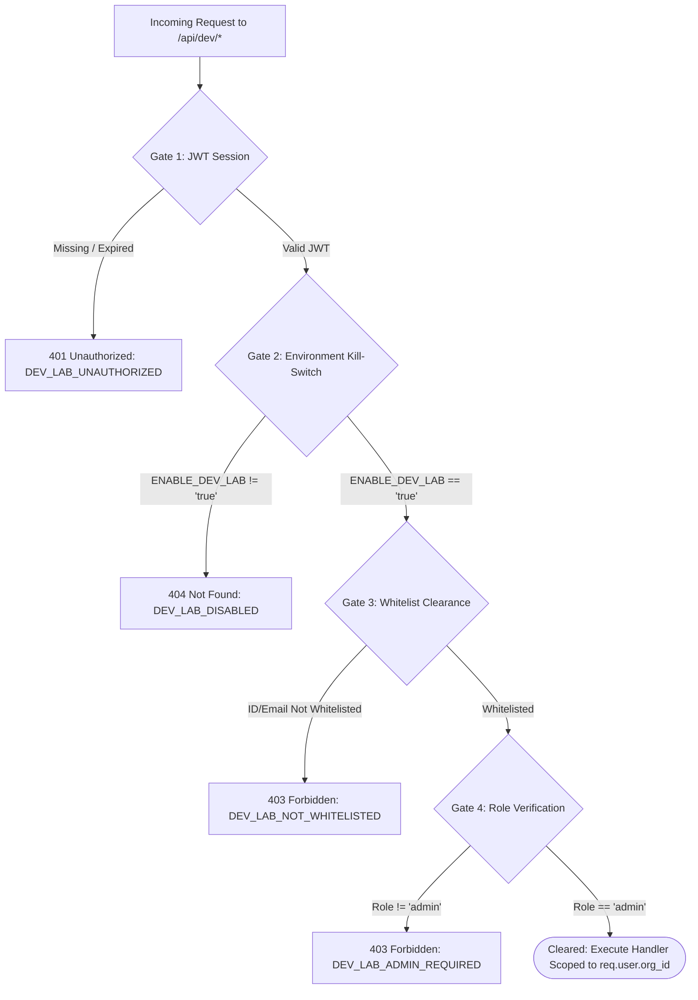

# Dev Lab Multi-Clearance Security Architecture

**Location**: `backend/src/middleware/devLabGuard.js`  
**Purpose**: Global security infrastructure safeguarding all internal testing laboratories and developer tooling across MANO-ERP (e.g. `/api/dev/*`).

---

## 1. Security Philosophy: Multi-Level Clearance

Developer labs and testing harnesses provide direct database manipulation and invariant checking capabilities that must **never** be accessible to regular users or exposed in unverified environments.

Rather than relying on a single door (such as environment mode or an admin flag alone), MANO-ERP enforces a **4-Gate Clearance Pipeline**. Even if one gate is misconfigured, subsequent independent gates catch unauthorized access.

---

## 2. The 4 Security Gates



### Gate 1: Verified User Authentication
* Enforced by `authenticateJWT`.
* Rejects unauthenticated traffic with `401 Unauthorized`.
* Resolves `req.user.id`, `req.user.email`, and `req.user.org_id`.

### Gate 2: Explicit Environment Kill-Switch
* Evaluates `ENABLE_DEV_LAB === 'true'` in `backend/.env`.
* If disabled or absent, dev lab routes are not mounted or respond with `404 Not Found`.
* Guarantees zero exposure in production environments even if an admin credentials leak.

### Gate 3: Named User ID & Email Whitelist
* Validates `req.user.id` against `DEV_LAB_ALLOWED_USERS` (e.g., `1,2`).
* Validates `req.user.email` against `DEV_LAB_ALLOWED_EMAILS` (e.g., `dev@mano.co.in`).
* Prevents other administrators within the organization from accessing raw testing engines.

### Gate 4: Administrator Role Clearance
* Enforces `isAdmin(req.user)`.
* Guarantees that any whitelisted account also possesses administrative privileges.

---

## 3. Environment Configuration (`backend/.env`)

```ini
# ========================================================
# 🧪 DEVELOPER TEST LAB (Strict Multi-Door Clearance)
# ========================================================
# Gate 2: Master Kill-Switch (Set to 'true' to mount and enable /api/dev/*)
ENABLE_DEV_LAB=true

# Gate 3: Whitelisted User IDs permitted to execute Dev Lab APIs
DEV_LAB_ALLOWED_USERS=1,2

# Gate 3: Whitelisted Email Addresses permitted to execute Dev Lab APIs
DEV_LAB_ALLOWED_EMAILS=admin@mano.co.in,dev@mano.co.in
```

---

## 4. How to Mount Future Dev Lab Modules

When creating a new internal test harness (e.g., Inventory Lab, DPR Lab), mount it in `backend/src/modules/index.js` wrapped with `isDevLabEnabled()` and apply `requireDevLabClearance`:

```javascript
import { authenticateJWT } from '../middleware/auth.js';
import { requireDevLabClearance, isDevLabEnabled } from '../middleware/devLabGuard.js';

const router = express.Router();
router.use(authenticateJWT);
router.use(requireDevLabClearance);

// Dev routes here...
```

