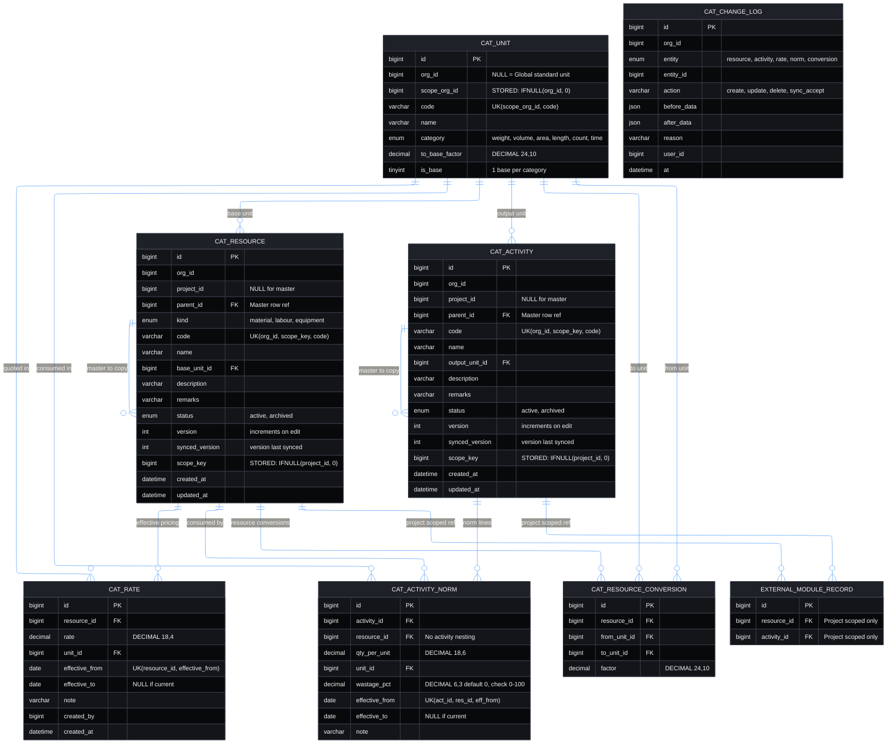

# Module 2: Catalog Module Guide & Integration Contract

**Document Version**: 1.0.0  
**Target Engine**: MySQL 8.0.16+ (`DECIMAL` exact math) / Node.js ES Modules / Express  
**Developer Test Page**: `/dev/catalog-lab`

---

## 1. Entity Relationship (ER) Architecture

The Catalog consists of 7 dedicated tables (`cat_*`) structured strictly around scopes (master vs. project), effective-dated rate/norm histories, and flat resource-only compositions (zero activity nesting).



---

## 2. Purpose & Guarantees

The Catalog answers one question: **what things exist?** It holds definitions only—units, resources (`material`, `labour`, `equipment`), effective-dated rates, and activities with flat resource-only norms. It never records stock, quantities, progress, or plans.

### Two-Tier Unit Architecture (Code-Sovereign Immutability)
- **Sovereign Code Registry (`catUnitRegistry.js`)**: Standard physical units (`kg`, `g`, `tonne`, `m`, `cm`, `mm`, `m2`, `m3`, `l`, `hr`, `min`, `nos`, etc.) are defined as deeply frozen in-memory constants. The calculation and conversion engines resolve physical factors directly from this registry, guaranteeing **100% mathematical immunity** against accidental direct database edits.
- **Global Database Rows (`org_id IS NULL`)**: Exist solely to satisfy relational SQL Foreign Keys (`cat_resource.base_unit_id -> cat_unit.id`), indexing, and fast queries. No organization duplicates them, and no tenant requires a per-org seed step.
- **Self-Healing & Drift Detection**: `checkIntegrity()` detects any missing or tampered DB rows (`SYSTEM_UNIT_TAMPERED`), and `repairSystemUnits()` self-heals DB rows to match the sovereign code constants.
- **Optional Database Triggers (`004_catalog_unit_triggers.sql`)**: Aborts direct SQL `UPDATE` and `DELETE` on global units.
- **Tenant Custom Units (`org_id NOT NULL`)**: Created only if an organization defines custom operational metrics (e.g. `shift = 10 hr`).
- **Resource Packaging & Scaling Metrics**: Material packaging conversions (`1 bag = 50 kg`, `1 truck = 10 m3`) are stored per-resource in `cat_resource_conversion`.

### 15 Invariants Guaranteed
1. **Master vs. Project Scope**: Master rows (`project_id IS NULL`) have `parent_id IS NULL`. Project copies point to a master of the same `org_id` and `kind`.
2. **Immutable Resource Kind**: A resource's `kind` (`material` | `labour` | `equipment`) never changes after creation (`CAT_KIND_MISMATCH`).
3. **Scoped Code Uniqueness**: `code` is unique per organization in the master catalog (`scope_key = 0`) and per project (`scope_key = project_id`) (`CAT_DUPLICATE_CODE`).
4. **Same-Scope Norms**: Project activity norms use only resources from the same project; master activity norms use only master resources (`CAT_SCOPE_MISMATCH`).
5. **No Nested Activities**: `cat_activity_norm.resource_id` references `cat_resource` only. Cycles are impossible by construction.
6. **Unit Compatibility**: A rate or norm unit must belong to the same category as the resource's base unit, or have a `cat_resource_conversion` linking the two categories (`CAT_UNIT_INCOMPATIBLE`).
7. **Non-Overlapping Effective Periods**: Rate periods per resource and norm periods per `(activity_id, resource_id)` never overlap (`CAT_RATE_OVERLAP`, `CAT_NORM_OVERLAP`). Setting a new rate/norm closes any open period the day before; concurrent writes lock the parent row with `SELECT ... FOR UPDATE`.
8. **Value Bounds**: `rate >= 0`, `qty_per_unit > 0`, `factor > 0`, and `effective_to >= effective_from` (`CAT_INVALID_VALUE`).
9. **Immutable Past History**: Past/active rates and norms are corrected only via `correctRate` / `correctNorm` with a mandatory `reason`; only future-dated rows (`effective_from > today`) may be removed via `removeRate` / `removeNorm`.
10. **Non-Propagating Master Edits**: Master edits bump `version` without altering project copies. Projects inspect `getSyncStatus` / `getSyncDiff` and selectively apply via `acceptSync`.
11. **Idempotent Imports**: `importResource` / `importActivity` lock the master row (`SELECT ... FOR UPDATE`) and reuse existing project copies unless `asNewVariant: true` is passed.
12. **Archive Protection**: Archived resources/activities remain readable for history, but cannot be added to new norms or imported (`CAT_ARCHIVED`).
13. **Delete & Base-Unit Protection**: Rows referenced by norms, project copies, or `registerUsageCheck` hooks can be archived but never deleted or have their base/output unit changed (`CAT_IN_USE`).
14. **On-Demand Activity Cost & Allowed Wastage**: Activity cost and expected material usages are never stored; they are computed strictly on demand with exact BigInt decimal arithmetic. Each norm in `cat_activity_norm` carries an estimation yardstick `wastage_pct` (`DECIMAL(6,3)` default 0, valid range 0%–100%) representing allowed waste or productivity allowance. Calculations evaluate `net = outputQty * qty_per_unit`, `gross = net * (1 + wastage_pct / 100)`, and `allowance = gross - net`. `expectedUsage` returns `{ netQty, allowanceQty, grossQty, unitId }` in the resource's base unit; `computeActivityCost` prices the `grossQty` with the effective rate, maintaining incomplete flags and warnings. This field serves estimation, budgeting, and variance analysis only—it never touches stock, never writes ledger events, and does not record actual loss (which is captured as later execution events).
15. **Complete Audit Trail**: Every mutation to a resource, activity, rate, norm, or conversion runs in a single transaction and writes one `cat_change_log` row.

---

## 3. Integration Contract for Other Modules

1. **Store only `resource_id` or `activity_id` (project-scoped)**:
   Call `assertProjectScoped('resource', id, projectId)` or `assertProjectScoped('activity', id, projectId)` on every event/document line.
2. **Never copy names, rates, or norms into another table**: Ask `catalogService` at read time.
3. **Never reimplement date/unit math**: Use `getRate`, `convert`, `computeActivityCost`, and `expectedUsage`.
4. **Register usage checks immediately** when your module adds a foreign key to `cat_resource` or `cat_activity`:
   ```javascript
   import { registerUsageCheck } from '../catalog/catalogService.js';
   registerUsageCheck('resource', async (ids) => {
       const rows = await db('my_event_lines').whereIn('resource_id', ids).distinct('resource_id');
       return rows.map(r => r.resource_id);
   });
   ```
5. **Archived rows**: Keep existing references valid for history; hide `status = 'archived'` in pickers for new records.
6. **Foreign-key direction**: Other modules may add FKs to `cat_*` tables; `cat_*` tables never reference other modules.

---

## 4. Service API Reference (`backend/src/modules/catalog/catalogService.js`)

| Group | Functions |
|---|---|
| **Units & Conversions** | `listUnits(orgId)`, `seedDefaultUnits(orgId)`, `createUnit(input)`, `updateUnit(id, patch)`, `convert(qty, fromUnitId, toUnitId, resourceId?)`, `setConversion(resourceId, fromUnitId, toUnitId, factor, opts?)`, `removeConversion(id, opts?)`, `listConversions(resourceId)` |
| **Resources** | `createResource(input)`, `updateResource(id, patch)`, `archiveResource(id)`, `restoreResource(id)`, `deleteResource(id)`, `getResource(id)`, `listResources(filter)`, `importResource(masterId, projectId, opts?)`, `getSyncStatus(id)`, `getSyncDiff(id)`, `acceptSync(id, selection)` |
| **Rates** | `setRate(resourceId, rate, unitId, effectiveFrom, note?)`, `getRate(resourceId, date, opts?)`, `listRates(resourceId)`, `correctRate(rateId, patch, reason)`, `removeRate(rateId, reason)` |
| **Activities & Norms** | `createActivity(input)`, `updateActivity(id, patch)`, `archiveActivity(id)`, `restoreActivity(id)`, `deleteActivity(id)`, `getActivity(id)`, `listActivities(filter)`, `importActivity(masterId, projectId, opts?)`, `getActivitySyncStatus(id)`, `getActivitySyncDiff(id)`, `acceptActivitySync(id, selection)`, `setNorm(activityId, resourceId, qtyPerUnit, unitId, effectiveFrom, note?)`, `getNorms(activityId, date)`, `correctNorm(normId, patch, reason)`, `removeNorm(normId, reason)` |
| **Computation** | `computeActivityCost(activityId, date)`, `expectedUsage(activityId, outputQty, date)` |
| **Housekeeping** | `registerUsageCheck(entity, fn)`, `assertProjectScoped(entity, id, projectId)`, `getChangeLog(entity, id)`, `checkIntegrity(scope?)` |

### Stable Error Codes (`CatalogError`)
`CAT_NOT_FOUND` (404), `CAT_DUPLICATE_CODE` (409), `CAT_KIND_MISMATCH`, `CAT_SCOPE_MISMATCH`, `CAT_UNIT_INCOMPATIBLE`, `CAT_NO_CONVERSION`, `CAT_RATE_OVERLAP`, `CAT_NORM_OVERLAP`, `CAT_IN_USE`, `CAT_ARCHIVED`, `CAT_NOT_MASTER`, `CAT_INVALID_VALUE` (all 400).

---

## 5. Schema, Standalone Initializer, Tests & Lab

- **Full HTTP Routes & Payload Specification**: [`CATALOG_API_ROUTES.md`](file:///c:/Mano/Code/GIT/MANO-ERP/backend/src/modules/catalog/CATALOG_API_ROUTES.md)
- **DDL**: `backend/src/db/sql/002_catalog_schema.sql` (zero DDL runs on server boot)
- **Initialize Tables (Manual by User)**: `node backend/src/db/initCatalogSchema.js` or execute `002_catalog_schema.sql` directly
- **Run 40 MySQL Integration Tests**: `node backend/src/modules/catalog/catalogTests.js` (or `node backend/src/modules/catalog/catalogTests.js 15` for a single case)
- **Dev Lab UI**: `/dev/catalog-lab` (backed by `/api/dev/catalog/*` behind `requireDevLabClearance`)

