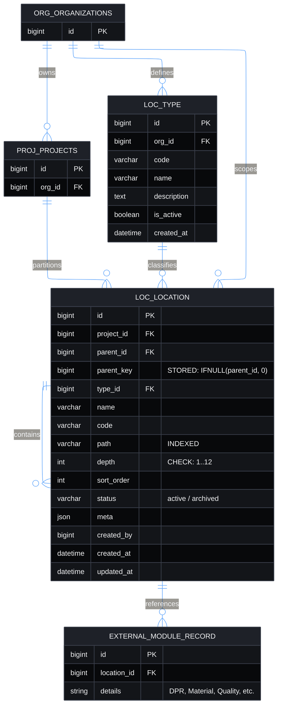

# Module 1: Location Module Guide & Integration Contract

**Document Version**: 1.1.0  
**Target Engine**: MySQL 8.0.16+ / Node.js ES Modules / Express  
**Developer Test Page**: `/dev/location-lab`

---

## 1. Entity Relationship (ER) Architecture

The Location module is purely partitioned by `project_id` (sole root, 3NF compliant) while vocabulary types (`loc_type`) belong to organizations (`org_id`). External modules reference only `location_id`.



---

## 2. Purpose & Guarantees

The Location module answers a single question: **where on the project did something happen?**  
It owns the project's location tree (site, tower, floor, unit, room, zone, grid, chainage segment) and nothing else. Later modules (DPR, Inventory, Quality, Contracts) store **only** a `location_id` and query this module for hierarchy, ancestry, and subtree roll-ups.

### Invariants Guaranteed
1. **Single Project Boundary**: Every location is a root (`parent_id IS NULL`) or has a parent belonging strictly to the same project (`project_id`).
2. **Acyclic Tree**: No location can ever be its own ancestor or descendant (`LOC_CYCLE`).
3. **Derived Path & Depth**:
   - Roots: `path = '/<id>/'`, `depth = 1`
   - Children: `path = '<parent_path><id>/'`, `depth = parent.depth + 1`
   - `parent_id` is the single source of truth for hierarchy; `path` and `depth` are fast indexed copies.
4. **Sibling Uniqueness**: Sibling names under the same parent (and roots within the same project) are strictly unique, case-insensitive (`LOC_DUPLICATE_NAME`).
5. **Organization Boundary**: A location's vocabulary type must belong to the location's organization (`LOC_TYPE_ORG_MISMATCH`).
6. **Max Depth Bound**: Configured default depth maximum is 8 (database schema allows up to 12) (`LOC_MAX_DEPTH`).
7. **Archive Protection**: Archived locations stay in the tree for historical integrity, but cannot receive new children or moves (`LOC_PARENT_ARCHIVED`).
8. **Delete Protection**: Locations with children (`LOC_HAS_CHILDREN`) or locations flagged as active by other modules via `registerUsageCheck` (`LOC_IN_USE`) can be archived but never deleted.
9. **Atomic Subtree Moves**: Subtree moves rewrite `path` and `depth` for the node and all its descendants in a single transaction.
10. **Immutable IDs**: Location IDs never change, regardless of renames, reorders, or moves.

---

## 3. Integration Contract for Other Modules

### Rule 1: Store ONLY `location_id`
Never duplicate or denormalize a location's `name` or `path` into your module's table.
```sql
-- CORRECT
CREATE TABLE mat_stock_entry (
    id BIGINT UNSIGNED NOT NULL AUTO_INCREMENT PRIMARY KEY,
    location_id BIGINT UNSIGNED NOT NULL,
    quantity DECIMAL(12, 4) NOT NULL,
    CONSTRAINT fk_stock_location FOREIGN KEY (location_id) 
        REFERENCES loc_location(id) ON DELETE RESTRICT
);
```

### Rule 2: Subtree Roll-ups (Never Walk the Tree Yourself)
To query records under a location (for example, "all material issues under Floor 3"):
```javascript
import { getDescendantIds } from '../locations/locationService.js';

// Fast index lookup
const descendantIds = await getDescendantIds(floor3LocationId);
const records = await db('mat_stock_entry')
    .whereIn('location_id', descendantIds);
```
Or use SQL range scan directly if joining `loc_location`:
```sql
SELECT s.* 
FROM mat_stock_entry s
JOIN loc_location l ON l.id = s.location_id
WHERE l.project_id = :projectId
  AND (l.path = :floorPath OR l.path LIKE CONCAT(:floorPath, '%'));
```
*Note: Stored paths always end in a trailing slash (`/1/5/`), preventing `/1/5/` from mistakenly matching `/1/50/`.*

### Rule 3: Register a Usage Check Hook
If your module references `location_id`, register a hook so users cannot accidentally delete referenced locations:
```javascript
import { registerUsageCheck } from '../locations/locationService.js';
import db from '../../config/database.js';

registerUsageCheck(async (locationIds) => {
    const inUse = await db('mat_stock_entry')
        .whereIn('location_id', locationIds)
        .distinct('location_id');
    return inUse.map(row => row.location_id);
});
```

---

## 3. Service API Reference

Import from `src/modules/locations/locationService.js`:

| Function | Signature | Description |
|---|---|---|
| `createLocation` | `(input, trx?)` | Creates a location under a parent or root. Enforces types, max depth, sibling uniqueness. |
| `updateLocation` | `(id, patch, trx?)` | Renames, changes code, sort order, or meta. Never modifies parent. |
| `moveLocation` | `(id, newParentId, sortOrder?, trx?)` | Atomically moves a location and its whole subtree. Validates cycles, depth, sibling clashes. |
| `archiveLocation` | `(id, { cascade }?, trx?)` | Soft-archives location (and optionally descendants). |
| `restoreLocation` | `(id, trx?)` | Restores an archived location if parent is active. |
| `deleteLocation` | `(id, trx?)` | Permanently deletes a leaf location (verifying usage check hooks). |
| `getLocation` | `(id, trx?)` | Fetches a single location joined with type information. |
| `listChildren` | `(projectId, parentId?, trx?)` | Lists direct children sorted by sort order and name. |
| `getTree` | `(projectId, options?, trx?)` | Returns the entire project hierarchy as a nested tree. |
| `getSubtree` | `(id, options?, trx?)` | Returns a location and all of its descendants as a nested tree. |
| `getDescendantIds` | `(id, trx?)` | Returns flat array of location IDs in subtree (including self). |
| `getAncestors` | `(id, trx?)` | Returns breadcrumb array from root down to parent. |
| `ensurePath` | `(projectId, segments, orgId, trx?)` | Idempotently creates missing hierarchy levels (for Excel imports). |
| `registerUsageCheck` | `(fn)` | Registers an external module usage check hook. |
| `checkIntegrity` | `(projectId, trx?)` | Runs 4 invariant verification queries and reports violations. |
| `rebuildPaths` | `(projectId, trx?)` | BFS repair tool that recomputes `path` and `depth` from `parent_id`. |

---

## 4. Stable Error Codes

All errors thrown by the service are instances of `LocationError`:

- `LOC_NOT_FOUND`: Target location, parent, or type does not exist.
- `LOC_CYCLE`: Attempted to move a location under itself or under one of its descendants.
- `LOC_DUPLICATE_NAME`: Sibling location with the same name exists under the same parent.
- `LOC_CROSS_PROJECT`: Parent belongs to a different project than child.
- `LOC_PARENT_ARCHIVED`: Cannot add child or move under an archived parent.
- `LOC_HAS_CHILDREN`: Cannot delete a non-leaf location.
- `LOC_IN_USE`: Location is currently referenced by other modules.
- `LOC_MAX_DEPTH`: Operation would violate the maximum depth limit (default 8).
- `LOC_TYPE_IN_USE`: Cannot delete a vocabulary type that is referenced by locations.
- `LOC_TYPE_ORG_MISMATCH`: Vocabulary type belongs to a different organization.

---

## 5. Database Schema & Migration

### Standalone Migration File
`backend/src/db/sql/001_location_schema.sql`

### Standalone CLI Initializer
```bash
node backend/src/db/initLocationSchema.js
```
*(Zero DDL operations run on server boot, fulfilling production cloud DB architecture requirements).*

---

## 6. Developer Test Page
Access the interactive test laboratory at:
```
http://localhost:5173/dev/location-lab
```
Features available in the lab:
- Project & Organization selector (open input for cross-tenant testing)
- Visual tree with inline CRUD, Archive, Restore, and Subtree Move
- Raw Row DB Inspector & Ancestors / Descendants preview
- Bulk paste importer (`ensurePath`)
- Vocabulary / Type Manager & Default Seeder
- In-Use Simulation Guard toggle
- Invariant integrity checker & 1-click `rebuildPaths()` repair button
- Real-time API call log with durations and error codes

*Security Note: Access to developer labs is governed globally by the [Dev Lab Multi-Clearance Security Architecture](../../middleware/DEV_LAB_SECURITY.md).*

---

## 7. Edge Case & Restriction Test Matrix

The following test cases can be run directly inside `/dev/location-lab` to verify every boundary guarantee:

| ID | Category | Test Scenario | Action in Location Lab | Expected Outcome | Error Code |
|---|---|---|---|---|---|
| **TC-01** | Sibling Uniqueness | Create two root locations with identical names | 1. Add root `"Tower A"`<br>2. Add another root `"Tower A"` | Request is rejected | `LOC_DUPLICATE_NAME` |
| **TC-02** | Case-Insensitive Clashes | Sibling name conflict with mixed casing | 1. Add child `"Floor 1"`<br>2. Add child `"floor 1"` under same parent | Rejected by unique index check | `LOC_DUPLICATE_NAME` |
| **TC-03** | Immediate Cycle | Move a node under itself | 1. Select `"Tower A"`<br>2. Choose "Move Subtree"<br>3. Pick `"Tower A"` as new parent | Rejected before database write | `LOC_CYCLE` |
| **TC-04** | Descendant Cycle | Move a parent under its own child or grandchild | 1. Have `Tower A -> Floor 1 -> Flat 101`<br>2. Select `Tower A`<br>3. Choose "Move Subtree"<br>4. Pick `Flat 101` as new parent | Rejected via materialized path prefix scan | `LOC_CYCLE` |
| **TC-05** | Max Depth Bound | Create or move nodes exceeding configured max depth (8) | Create a chain of nested locations 9 levels deep (`L1/L2/.../L9`) | Rejected at depth 9 | `LOC_MAX_DEPTH` |
| **TC-06** | Delete Non-Leaf | Attempt to permanently delete a location that has children | 1. Select `Tower A` (which has children)<br>2. Click Delete button | Deletion blocked; user prompted to Archive instead | `LOC_HAS_CHILDREN` |
| **TC-07** | In-Use Foreign Lock | Delete a leaf node that is actively referenced by another module | 1. Select leaf `Flat 101`<br>2. In Inspector, click "Simulate Reference by Other Module (In-Use)"<br>3. Click Delete button | Blocked by `registerUsageCheck` hook | `LOC_IN_USE` |
| **TC-08** | Archived Parent Lock | Add child under an archived parent | 1. Archive `Floor 1`<br>2. Attempt to add child `"Unit 105"` under `Floor 1` | Creation blocked | `LOC_PARENT_ARCHIVED` |
| **TC-09** | Move to Archived | Move active node under an archived parent | 1. Archive `Tower B`<br>2. Try to move `Floor 1` under `Tower B` | Move blocked | `LOC_PARENT_ARCHIVED` |
| **TC-10** | Cross-Org Tenant Lock | Enter a `projectId` belonging to a different organization | In header, change `Project ID` to an ID belonging to a different `org_id` | Blocked by clearance guard | `LOC_CROSS_PROJECT` |
| **TC-11** | Vocabulary Type In-Use | Delete a location type currently referenced by nodes | In "Manage Types", attempt to delete type `"FLOOR"` while Floor nodes exist | Type deletion blocked | `LOC_TYPE_IN_USE` |
| **TC-12** | Bulk Path Idempotency | Paste the same hierarchy text twice in "Bulk Paste Paths" | 1. Paste `Tower A / Floor 1 / Unit 101`<br>2. Click "Parse & Ensure Paths"<br>3. Paste same text again & run | Zero duplicates created; existing nodes reused | `SUCCESS` |
| **TC-13** | Subtree Atomic Path Rewrite | Move an entire multi-level branch under a new parent | Move `Floor 1` (with 5 units) from `Tower A` to `Tower B` | Single atomic query updates paths & depths for all 6 nodes | `SUCCESS` |
| **TC-14** | Invariant Self-Healing | Verify tree integrity or repair corrupted paths | 1. Click "Check Integrity" (reports 0 violations)<br>2. Click "Rebuild Paths" | BFS traversal recomputes all materialized paths safely | `SUCCESS` |


