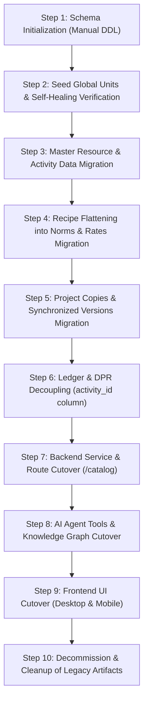

# Legacy Resource Catalog Cutover Audit Report

**Date**: November 2026  
**Auditor**: Antigravity AI Engine  
**System**: MANO-ERP  
**Objective**: Comprehensive technical audit of the legacy resource catalog (`res_resources`, `res_rates`, `res_compositions`, `res_conversions`) and its dependents to prepare for cutover to the new Catalog module (`cat_*`).  
**Constraint**: Read-only codebase audit. Zero source modifications outside this document.

---

## A. Inventory Table

The following inventory details every file across backend, frontend, scripts, seeds, tests, and documentation that references the legacy catalog, what it does, what legacy construct it uses, its new Catalog equivalent, estimated change size, and technical risk.

| File Path | What It Does | Legacy Thing It Uses | New Catalog Equivalent (Service / Table) | Change Size | Risk |
|---|---|---|---|---|---|
| `backend/server.js:22, 62` | Server entrypoint; invokes startup schema migrations | `initializeResourceSchema()` altering `res_*` tables on boot | **Remove entirely** (violates AGENTS.md rule: zero DDL on server boot) | S | Low |
| `backend/src/modules/index.js:8-9, 32-33, 46` | Main route registry mounting Express sub-routers | Mounts `/units` (`unitRoutes.js`) and `/resources` (`resourceRoutes.js`) | Replaced by `/catalog` (`catalogRoutes.js`) or forward legacy routes | S | Medium |
| `backend/src/modules/inventory/resourceService.js:1-2374` | Legacy catalog service (CRUD, rates, recipes, conversions, bulk upload, deep clone) | `res_resources`, `res_rates`, `res_compositions`, `res_conversions`, `initializeResourceSchema()`, unit conversion math | `catalogService.js` (`cat_resource`, `cat_rate`, `cat_activity`, `cat_activity_norm`, `cat_resource_conversion`, `cat_unit`) | L | High |
| `backend/src/modules/inventory/resourceController.js:1-370` | HTTP controller for `/api/resources/*` | Calls `resourceService` methods (CRUD, rates, compositions, conversions, bulk) | `catalogController.js` (`/api/catalog/*`) | L | High |
| `backend/src/modules/inventory/resourceRoutes.js:1-41` | Express routes for `/api/resources` | Exposes 17 endpoints for legacy resources, compositions, rates, bulk | `catalogRoutes.js` (or adapter routes redirecting to Catalog API) | M | Medium |
| `backend/src/services/compositionResolver.js:1-146` | Composition tree resolution, DAG cycle detection (`detectCycle`, `checkCycles`), column resolution | `res_compositions`, `res_resources`, checks for nested items | **Obsolete / Retire**. Invariant 5 guarantees flat norms with zero nesting; cycles impossible | M | Low |
| `backend/src/services/unitRegistry.js:1-314` | In-memory float unit constants, aliases, dynamic fallback parsing | In-memory registry with IEEE-754 floats; dynamic string unit fallback | `catUnitRegistry.js` (frozen exact decimal constants) & `cat_unit` table | M | Medium |
| `backend/src/modules/units/unitService.js:1-33` | Service returning unit dictionary for dropdowns | Reads `UNIT_REGISTRY` from `unitRegistry.js` | `catalogService.listUnits(orgId)` querying `cat_unit` | S | Low |
| `backend/src/modules/units/unitController.js:1-12` | Controller for `/api/units` | Calls `unitService.getUnits()` | `catalogController.listUnits` | S | Low |
| `backend/src/modules/units/unitRoutes.js:1-10` | Route definition for `/api/units` | Mounts `listUnits` | Replaced by `/api/catalog/units` | S | Low |
| `backend/src/modules/projects/resources/projectResourceService.js:1-206` | Project resource catalog adapter (import, rates, child cleanup) | `res_resources` (`project_id`, `parent_id`), `res_rates`, `res_compositions`, `res_conversions` | `catalogService.listResources`, `catalogService.listActivities`, `importResource`, `importActivity`, `setRate` | L | High |
| `backend/src/modules/projects/resources/projectResourceController.js:1-165` | Controller for `/api/projects/:id/resources/*` | Calls `projectResourceService` methods | Delegate to `catalogService` project-scoped methods | M | Medium |
| `backend/src/modules/projects/resources/projectResourceRoutes.js:1-24` | Route definitions for project resources | Exposes 11 endpoints under `/api/projects/:id/resources` | Rewire to new Catalog project routes or deprecate | S | Medium |
| `backend/src/modules/ledger/ledgerService.js:12-38, 73-83, 125-135, 154-159, 283, 340, 355` | General ledger transaction creation and stock position verification | Verifies `project_resource_id` against `res_resources.project_id`, writes to `txn_transaction_lines` | `catalogService.assertProjectScoped('resource', id, projectId)` against `cat_resource`; add nullable `activity_id` for DPR | M | High |
| `backend/src/modules/ledger/ledgerValidation.js:28, 60-73` | Transaction line balance validation | Validates zero-sum balance per `project_resource_id` on transfers | Kept for `project_resource_id` pointing to `cat_resource` | S | Medium |
| `backend/src/modules/ledger/ledgerController.js:69, 108, 119` | HTTP controller for ledger transactions | Reads `project_resource_id` from params/body | Kept, accept optional `activity_id` | S | Low |
| `backend/src/modules/agent/agentReadService.js:20-80, 136-146, 631-655` | AI Agent read tools and DPR transaction parser | `resources.search`, `resources.get`, `resources.getRate`, `resources.getRateHistory`, `resources.getComposition`, `parseDprTransaction` | Rewire to `catalogService` (`getResource`, `listResources`, `getRate`, `listRates`, `getNorms`, `computeActivityCost`) | M | Medium |
| `backend/src/modules/agent/agentWriteService.js:327-335, 432-440, 682-686, 773-775` | AI Agent write tools | Queries and writes to `res_resources` and `res_rates` | `catalogService.createResource`, `updateResource`, `setRate`, `setConversion` | M | Medium |
| `backend/src/modules/agent/agentTools.js:54-59, 74, 209` | Tool declarations and type validation | Resource tools declaration; enum validation `['material', 'labour', 'item']` | Update tool schemas to `['material', 'labour', 'equipment']` and add activity tools | M | Medium |
| `backend/src/modules/agent/agentEvents.js:172-175` | Event formatting for audit logging | Mentions `resources.simulateCostImpact` | Replaced by `computeActivityCost` event auditing | S | Low |
| `backend/src/modules/agent/agentPolicy.js:46-51` | Access policy authorization checks | Queries `res_resources` for `org_id` and `project_id` matching | Query `cat_resource` and `cat_activity` | S | Low |
| `backend/src/modules/agent/agentAnalyticsService.js:74-82` | Analytics reporting dimensions | Queries `res_resources` with dimensions `type` and `base_unit_code` | Query `cat_resource` (`kind`, `base_unit_id -> cat_unit.code`) | S | Low |
| `backend/src/modules/agent/agentExportService.js:117-143` | Excel report generator for resources/materials | Joins `res_resources` and `res_rates` on `r.id = rr.resource_id` | Join `cat_resource` and `cat_rate` | S | Low |
| `backend/src/modules/knowledge/kgDatabaseListener.js:56-60` | Knowledge Graph DB event listener | Listens to `res_resources`, `res_rates`, `res_compositions`, `res_conversions` | Listen to `cat_resource`, `cat_rate`, `cat_activity`, `cat_activity_norm`, `cat_resource_conversion` | S | Low |
| `backend/src/modules/knowledge/knowledgeGraphService.js:683-694` | Page context resolver for Knowledge Graph | Maps tables `res_compositions`, `res_rates`, `res_conversions`, `res_*` | Map `cat_activity`, `cat_activity_norm`, `cat_rate`, `cat_resource` | S | Low |
| `backend/src/modules/knowledge/knowledgeRules.js:167, 227, 376-406, 480, 564, 744-774, 823, 832, 871, 1070-1114, 1299-1323` | Knowledge Graph schema rules and node links | Defines `schema:res_resources`, `schema:res_rates`, `schema:res_compositions`, `schema:res_conversions` | Update rules and nodes to `schema:cat_*` | M | Low |
| `backend/src/modules/ai/python_engine/agent_reasoning.py:26, 405, 421, 459, 952, 986` | Python AI agent reasoning and tool orchestration | References `resources.*` tools including `resources.getComposition` and `resources.simulateCostImpact` | Update tools to `catalog.getResource`, `catalog.getNorms`, `catalog.computeActivityCost` | S | Low |
| `backend/src/modules/ai/python_engine/agent_schemas.py:330, 409, 577` | Python Pydantic tool schemas | `Literal["material", "labour", "item"]` | `Literal["material", "labour", "equipment"]` and new Activity schemas | S | Low |
| `backend/knowledge/resources/impact-tracing.md:1-37` | Architectural knowledge base doc on rate impact tracing | Documents traversal: `res_rates -> res_compositions -> res_resources` | Update to document `cat_rate -> cat_activity_norm -> cat_activity` on-demand computation | M | Low |
| `backend/knowledge/resources/index.md:1-55` | Documentation of legacy resource model | Details `res_resources` and children | Rewrite for `cat_*` architecture | M | Low |
| `backend/knowledge/resources/compositions.md:1-65` | Documentation of legacy composition recipes | Details `res_compositions` | Rewrite for `cat_activity_norm` | M | Low |
| `backend/knowledge/resources/rate-versioning.md:1-50` | Documentation of legacy rate versioning | Details `res_rates` manual vs computed | Rewrite for `cat_rate` effective dating | M | Low |
| `frontend/src/services/resourceApi.js:1-98` | Frontend Axios client API for resources | Exposes 18 methods calling `/resources/*` | Re-point to `/catalog/*` endpoints | M | High |
| `frontend/src/services/projectApi.js:32-72` | Frontend Axios client API for project resources | Exposes 11 methods calling `/projects/:projectId/resources/*` | Re-point to `/catalog/projects/:projectId/*` | M | High |
| `frontend/src/services/dprApi.js:41-46, 78-94, 98-116, 158-163` | Formatter & API client saving DPR to general ledger | Maps `itemName` to `findResourceId` (`project_resource_id`), saves to `/ledger/transactions` | Map progress rows to `activity_id` (`cat_activity` project copy); keep `project_resource_id` for materials | M | High |
| `frontend/src/pages/Resources/ResourceList.jsx:1-101` | Main master catalog tab container | Manages 4 tabs: Directory, Recipes, Rates, Conversions via `resourceApi.getResources` | Update to load from Catalog API, split Items into Activities tab | M | Medium |
| `frontend/src/pages/Resources/ResourceDirectoryTab.jsx:1-300+` | Master resource ExcelGrid table | Filter buttons for All, Materials, Items, Labour; bulk inline edits | Update filter to Materials, Labour, Equipment; link to Activities | M | Medium |
| `frontend/src/pages/Resources/ResourceDetail.jsx:1-900+` | Resource detail inspector/drawer | Tabs for General, Conversions, Rates, Compositions (only for item) | Remove Compositions tab; update fields to `kind` and `base_unit_id` | L | Medium |
| `frontend/src/pages/Resources/ResourceForm.jsx:1-500+` | Resource creation modal | Type selector with `material`, `item`, `labour`; inline composition builder for items | Drop `item`, add `equipment`, remove recipe builder | M | Medium |
| `frontend/src/pages/Resources/ResourceRatesTab.jsx:1-800+` | Rate history manager and inspector | Rate version list; manual vs computed mode toggle for items | Resources have manual rates only; activity cost computed via norms | M | Medium |
| `frontend/src/pages/Resources/ResourceRecipesTab.jsx:1-700+` | Bill of Materials (BOM) recipe builder | Multi-level recipe builder, cycle detection warnings, component list | Replaced by Activity Norms page (`cat_activity` + `cat_activity_norm`) | L | High |
| `frontend/src/pages/Resources/ResourceConversionsTab.jsx:1-400+` | Packaging conversions manager | CRUD on resource unit conversions via `resourceApi.addConversion` | Rewire to `cat_resource_conversion` and `cat_unit` | M | Low |
| `frontend/src/pages/Resources/ResourceBulkUpload.jsx:1-430` | CSV/Excel drag & drop bulk upload wizard | Parses `Name,Code,Type,Base Unit,Rate,Rate Unit,Description,Remarks`; calls `bulkValidate` and `bulkJson` | Replaced/adapted for `cat_resource` (material, labour, equipment) | M | Medium |
| `frontend/src/pages/Resources/ResourceRate.jsx:1-800+` | Legacy "Rate Lab" test page | Interactive workbench for manual vs computed rate resolution | **Deprecate** (superseded by `/dev/catalog-lab` / `CatalogLab.jsx`) | M | Low |
| `frontend/src/pages/Resources/resourceConstants.js:1-160` | Client-side copy of unit registry | Duplicates legacy `unitRegistry.js` constants and symbols | Replace with client constants matching `catUnitRegistry.js` | S | Low |
| `frontend/src/pages/ProjectDetails/MaterialManagement/MaterialManagementIndex.jsx:1-244` | Project material management tab router | Filters `itemsOnly = allMapped.filter(p => p.type === 'item')` | Split into Project Resources (`cat_resource`) and Project Activities (`cat_activity`) | M | High |
| `frontend/src/pages/ProjectDetails/MaterialManagement/ProjectResourceList.jsx:1-1200+` | Project resource catalog grid & import dialog | Project resource grid, rate overrides, computed mode for items, batch import | Rewire to `catalogService` project endpoints (`listResources`, `importResource`, `setRate`) | L | High |
| `frontend/src/pages/ProjectDetails/Reports/Daily/DPRCreate.jsx:381-395, 1515, 1628` | Desktop DPR entry form | Filters `projectResources` where `type === 'item' \|\| type === 'work'` for Today's Progress / Tomorrow's Plan | Query `cat_activity` project rows instead of `res_resources` | M | High |
| `frontend/src/pages/Units/Units.jsx`, `UnitList.jsx`, `ResourceConversions.jsx`, `ConversionForm.jsx` | Legacy unit and conversion management pages | Deprecated unit management pages (redirected in `App.jsx` to `/resources`) | Unit management now fully handled in Catalog module | S | Low |
| `frontend/src/mobile/hooks/useMobileResources.js:1-10` | Mobile resource query hook | Calls `resourceApi.getResources({ limit: 50000 })` | Re-point to `catalogApi.listResources` | S | Low |
| `frontend/src/mobile/pages/Resources/MobileResources.jsx:1-50` | Mobile resource container page | Wraps mobile directory, rates, recipes, conversions | Adapt tabs to Resources vs Activities | M | Medium |
| `frontend/src/mobile/pages/Resources/MobileResourceDirectory.jsx:1-120` | Mobile resource directory list | Lists resources by type (`material`, `item`, `labour`) | Replace `item` with `equipment` | S | Low |
| `frontend/src/mobile/pages/Resources/MobileResourceRates.jsx:1-150` | Mobile resource rates tab | Reads rates for resources | Rewire to `cat_rate` | S | Low |
| `frontend/src/mobile/pages/Resources/MobileResourceRecipes.jsx:1-180` | Mobile item recipes tab | Displays recipes for items | Rewire to `cat_activity` and `cat_activity_norm` | M | Medium |
| `frontend/src/mobile/pages/Resources/MobileResourceConversions.jsx:1-100` | Mobile conversions tab | Displays unit conversions | Rewire to `cat_resource_conversion` | S | Low |
| `frontend/src/mobile/pages/Resources/MobileResourceBulkUpload.jsx:1-50` | Mobile bulk upload entry | Wraps bulk upload wizard | Rewire to new resource bulk upload | S | Low |
| `frontend/src/mobile/pages/ProjectDetails/MaterialManagement/MobileProjectMaterialManagement.jsx:1-160` | Mobile project material management | Reads project resources and rates | Rewire to `catalogService` project resources | M | Medium |
| `frontend/src/mobile/pages/ProjectDetails/MaterialManagement/mobileMaterialModel.js:1-60` | Mobile material view model | Maps `project_resource_id` / `resource_id` | Map to `cat_resource` | S | Low |
| `frontend/src/mobile/pages/ProjectDetails/Reports/MobileDailyReportWizard.jsx:1-250` | Mobile DPR wizard | Selects project resource suggestions for progress items | Select from project `cat_activity` rows | M | Medium |
| `frontend/src/mobile/pages/ProjectDetails/Transactions/MobilePartyStockStatements.jsx:15-30` | Mobile party stock statement | Maps `project_resource_id` to resource name | Reads `cat_resource` | S | Low |
| `backend/src/test/lemonade.json:1-56` | Test fixture for dynamic recipe bulk import | Defines `material`, `labour`, and composite `item` with nested `compositions` | Update fixture to Catalog schema (`resources` + `activities` with `norms`) | S | Low |
| `backend/src/test/bulkImporter.js:1-70` | Test script for bulk recipe import | Calls `resourceService.bulkInsertResources` on `lemonade.json` | Migrate test script to Catalog service calls | S | Low |
| `backend/src/test/runTests.js:1-120` | Legacy unit and composition test runner | Tests `res_resources`, `res_compositions`, cycle detection | Superseded by `catalogTests.js` (44 comprehensive integration test cases) | M | Low |
| `backend/tests/agent/persistence.test.js:58-70` | Agent DB persistence test | Creates in-memory `res_resources` and `res_rates` | Update table names to `cat_resource` and `cat_rate` | S | Low |
| `backend/tests/agent/tools.test.js:82-120` | Agent tool test suite | Fixtures with `res_resources` and `res_rates` | Update fixtures to `cat_resource` and `cat_rate` | S | Low |
| `frontend/tests/mobile/m3Harness.jsx:90-95` | Mobile mock harness | Mocks `projectApi.importResource` | Update mock payload | S | Low |
| `frontend/tests/mobile/m7Harness.jsx:30-85` | Mobile material management mock harness | Mocks `listProjectResources`, `importResource`, `importResourcesBatch` | Update mock contracts to Catalog API | S | Low |
| `frontend/tests/mobile/mobileProjectM7Contracts.test.js:85-95` | Mobile project material tests | Tests `importResource` and `importResourcesBatch` | Update test expectations | S | Low |
| `frontend/tests/mobile/mobileProjectM8Contracts.test.js:25-45` | Mobile transaction contracts tests | Asserts `project_resource_id` validation in register rows | Retain validation on `cat_resource` | S | Low |

---

## B. Foreign Keys and Data Dependencies

The following table catalogs every table and column in the database referencing the legacy tables, along with the required post-cutover target reference.

| Referencing Table | Referencing Column(s) | Current Target (Legacy) | Constraint / Action in Schema | Post-Cutover Target (New Catalog) | Required Migration Action |
|---|---|---|---|---|---|
| `proj_resources` | `resource_id` | `res_resources(id)` | `CONSTRAINT fk_pr_resource FOREIGN KEY (resource_id) REFERENCES res_resources(id) ON DELETE CASCADE` (schema dump line 587) | `cat_resource(id)` or **DROP TABLE** | Code comments in `ledgerService.js:14` and `projectResourceService.js:9` confirm `proj_resources` was superseded by copied `res_resources` rows. Drop this legacy join table or re-target to `cat_resource`. |
| `res_compositions` | `parent_resource_id` / `item_id` | `res_resources(id)` | `CONSTRAINT res_compositions_parent_resource_id_foreign FOREIGN KEY (parent_resource_id) REFERENCES res_resources(id) ON DELETE CASCADE` (schema dump line 666) | `cat_activity_norm.activity_id` -> `cat_activity(id)` | Transformed: The parent item becomes `cat_activity(id)`; the relationship is moved to `cat_activity_norm.activity_id`. |
| `res_compositions` | `component_resource_id` / `component_id` | `res_resources(id)` | `CONSTRAINT res_compositions_component_resource_id_foreign FOREIGN KEY (component_resource_id) REFERENCES res_resources(id) ON DELETE CASCADE` (schema dump line 665) | `cat_activity_norm.resource_id` -> `cat_resource(id)` | Re-targeted to `cat_resource(id)`. **Invariant 5**: Cannot point to an activity. Nested item recipes must be flattened into base resources. |
| `res_compositions` | `project_id` | `proj_projects(id)` | `CONSTRAINT fk_comp_project FOREIGN KEY (project_id) REFERENCES proj_projects(id) ON DELETE CASCADE` (schema dump line 664) | N/A (Scope inherited via `cat_activity.project_id`) | In the new Catalog, norms do not carry `project_id`; scope is strictly inherited from `cat_activity.project_id` (**Invariant 4**). |
| `res_rates` | `resource_id` | `res_resources(id)` | `CONSTRAINT fk_rate_resource FOREIGN KEY (resource_id) REFERENCES res_resources(id)` (schema dump line 708) | `cat_rate.resource_id` -> `cat_resource(id)` | Re-targeted to `cat_resource(id)`. Rates apply exclusively to resources; activities never have rates. |
| `res_rates` | `project_id` | `proj_projects(id)` | `CONSTRAINT fk_res_rates_project FOREIGN KEY (project_id) REFERENCES proj_projects(id) ON DELETE CASCADE` (schema dump line 709) | N/A (Scope inherited via `cat_resource.project_id`) | Project rates belong to the project-copy resource row (`cat_resource.project_id = projectId`); `cat_rate` itself carries no `project_id`. |
| `res_conversions` | `resource_id` | `res_resources(id)` | `CONSTRAINT res_conversions_resource_id_foreign FOREIGN KEY (resource_id) REFERENCES res_resources(id) ON DELETE CASCADE` (schema dump line 682) | `cat_resource_conversion.resource_id` -> `cat_resource(id)` | Re-targeted to `cat_resource(id)`. Conversions are defined per-resource between `from_unit_id` and `to_unit_id` in `cat_unit`. |
| `res_resources` (self-ref) | `parent_id` | `res_resources(id)` | `CONSTRAINT fk_res_resources_parent FOREIGN KEY (parent_id) REFERENCES res_resources(id) ON DELETE CASCADE` (added via startup DDL in `resourceService.js:101`) | `cat_resource.parent_id` -> `cat_resource(id)` & `cat_activity.parent_id` -> `cat_activity(id)` | Master-to-project copy link. Retained in both `cat_resource` and `cat_activity` with `ON DELETE RESTRICT` (**Invariant 1**). |
| `res_resources` | `project_id` | `proj_projects(id)` | `CONSTRAINT fk_res_resources_project FOREIGN KEY (project_id) REFERENCES proj_projects(id) ON DELETE CASCADE` (added via startup DDL in `resourceService.js:84`) | `cat_resource.project_id` & `cat_activity.project_id` | Master rows have `project_id IS NULL`; project copies carry `project_id`. Unique constraints enforced via generated `scope_key`. |
| `txn_transaction_lines` | `resource_id` (SQL dump) / `project_resource_id` (code) | `res_resources(id)` | No explicit DB foreign key constraint in schema dump (line 740); verified at application level in `ledgerService.js:16-38` | `cat_resource(id)` (project-scoped rows) | Physical inventory movements continue using `project_resource_id` referencing project-scoped `cat_resource(id)`. Verified with `assertProjectScoped('resource', id, projectId)`. |
| `txn_transaction_lines` | `activity_id` (Proposed new column) | N/A | New nullable column `activity_id INT UNSIGNED NULL` | `cat_activity(id)` (project-scoped rows) | Required for DPR daily progress lines. Verified with `assertProjectScoped('activity', id, projectId)`. |
| `txn_transactions` | `activity_id` | Unenforced integer in legacy schema | In `txn_transactions` header (schema dump line 758 / `ledgerService.js:109`), currently unused/unenforced | `cat_activity(id)` | Header-level activity reference can optionally point to project-scoped `cat_activity(id)` for activity-based vouchers. |

---

## C. "Item" Usage

In the legacy architecture, an `item` was treated as a special subtype of `res_resources` (`type = 'item'`). In the new Catalog module, **"item" no longer exists as a resource type**. All items are elevated to first-class entities in `cat_activity`, while `cat_resource` is strictly restricted to `material`, `labour`, and `equipment`.

### Inventory of Every Place an "Item" is Stored or Consumed

| Location | Exact Rows / Columns Involved | Current Behavior & Flow | Proposed Target | What Breaks if Changed Without Preparation |
|---|---|---|---|---|
| `res_resources.type` | Column `type` (`enum('material', 'item', 'labour')`) | Master and project rows for items (e.g. "Concrete M20", "Brick Masonry 1:4") stored directly in `res_resources`. | Move to `cat_activity` table (`code`, `name`, `output_unit_id`, `description`, `remarks`). | Any query filtering `WHERE type = 'item'` in `res_resources` returns 0 rows. Application code expecting item IDs in resource tables fails. |
| `res_compositions` Parent | Columns `parent_resource_id` / `item_id` | Only resources of type `item` could own compositions (`res.type === 'item'` enforced in `resourceService.js:435, 1796`). | Move to `cat_activity_norm.activity_id` referencing `cat_activity(id)`. | Code checking `item.type === 'item'` before loading recipes must be rewired to check `cat_activity`. |
| `res_compositions` Component (Nested Items) | Column `component_resource_id` / `component_id` | Legacy `compositionResolver.js:48-63` and `resourceService.js:1682-1736` allowed items to be components of other items (multi-level recipes with cycle checks). | **Forbidden by Catalog Invariant 5**. Component must be a `cat_resource(id)`. | **Breaking Change**: Any multi-level BOM (e.g., Concrete containing Mortar mix) cannot be inserted into `cat_activity_norm`. Must be flattened into pure resources (cement, sand, aggregate, water) during data migration. |
| `res_rates` for Items | Columns `res_rates.resource_id`, `res_rates.rate` | Legacy allowed manual rate overrides for items, which superseded computed recipe rates (`resourceService.js:377-434`). | **Drop item rates**. Activity cost is *never stored* and is evaluated strictly on-demand via `computeActivityCost(activityId, date)`. | Any UI or report that reads a static rate column for an item breaks. Must call `catalogService.computeActivityCost()`. |
| General Ledger Lines | `txn_transaction_lines.project_resource_id` | When DPR progress items match a project resource of type `item`, `dprApi.js:78` saves the item's ID into `project_resource_id`. | Move to `txn_transaction_lines.activity_id` referencing `cat_activity(id)`. | `ledgerService.js:16-38` verifies `project_resource_id` against `res_resources`. If an activity ID is passed as a resource ID, verification fails with `AppError: Project resource is not imported`. |
| DPR Entry Forms | `frontend/src/pages/ProjectDetails/Reports/Daily/DPRCreate.jsx:381-395` | Fetches project resources, filters `item.type === 'item' \|\| item.type === 'work'`, populates Today's Progress / Tomorrow's Plan dropdowns. | Call `catalogApi.listActivities(projectId)` to populate progress item dropdowns. | If DPR continues fetching `listProjectResources`, the progress item dropdown will be completely empty because `cat_resource` has no items. |
| Material Management Index | `frontend/src/pages/ProjectDetails/MaterialManagement/MaterialManagementIndex.jsx:139` | Filters `itemsOnly = allMapped.filter(p => p.type === 'item')` to power the "Recipes & History" project sub-tab. | Split UI: Load activities via `listActivities({ projectId })` for the Recipes tab; load resources via `listResources({ projectId })` for the Resource Grid. | The Recipes tab in project Material Management will show 0 items. |
| Master Resource Directory | `frontend/src/pages/Resources/ResourceDirectoryTab.jsx:74` | Filter button `Items` filters resources by `type === 'item'`. | Replace `Items` filter with `Equipment`; add navigation or split tab for Master Activities. | Users will be unable to find or view composite items in the master catalog directory. |
| Resource Edit Drawer | `frontend/src/pages/Resources/ResourceDetail.jsx:289, 773` | Shows "Compositions" tab only when `formData.type === 'item'`. | Remove Compositions tab from ResourceDetail; create dedicated ActivityDetail drawer. | Editing an item in the resource drawer will no longer be possible. |
| CSV/Excel Bulk Upload Template | `frontend/src/pages/Resources/ResourceBulkUpload.jsx:73, 95, 216` | Sample template contains `Ready Mix Concrete M20,ITM-RMC20,item,cum,,,Composite concrete mix`. Parser validates `['material', 'item', 'labour']`. | Disallow `type = 'item'` in resource upload; create dedicated Activity bulk upload template. | Uploading legacy CSVs with `Type = item` will fail validation with `Invalid type`. |
| Agent Tools & Schema | `backend/src/modules/agent/agentTools.js:209`, `agent_schemas.py:330, 409` | Tool argument schemas enforce `type: Literal['material', 'labour', 'item']`. | Update tool definitions to `['material', 'labour', 'equipment']` and add activity tools (`activities.search`, `activities.getCost`). | AI agent tool validation fails whenever asking about composite items. |

---

## D. DPR and Old Transaction Module

### 1. Exactly Which Fields Reference Resources or Items
In the current MANO-ERP codebase, Daily Progress Reports (DPR) do not use dedicated `proj_dprs` or `dpr_entries` tables (those exist only in historical 2026-08 SQL dumps as dead tables). Instead, DPR is fully implemented on top of the General Ledger voucher tables:
- **`txn_transactions` (Header)**:
  - `id`: Auto-increment voucher ID (`dprId`).
  - `txn_type`: Fixed enum value `'DAILY_PROGRESS'`.
  - `project_id`: Target project.
  - `txn_date`: The report date.
  - `activity_id`: Existing nullable column on header (`ledgerService.js:109`), currently unused by DPR lines.
  - `remarks`: JSON-stringified metadata holding weather, site condition, time slots, distribution, prepared by, and general remarks (`agentReadService.js:104-109`, `dprApi.js:146-163`).
- **`txn_transaction_lines` (Lines)**:
  - `party_id`: Integer referencing `proj_parties.pv_id`. For progress lines, defaults to `fallbackPartyId` (`dprApi.js:37-40`).
  - `project_resource_id`: **The critical coupling field**. For Labour lines and Event lines, this is `null`. For `TODAY_PROGRESS` and `TOMORROW_PLAN` lines, `dprApi.js:78, 100` matches `row.item` against the loaded project resources (filtered for `type === 'item'`) and writes `project_resource_id = resId`.
  - `signed_qty`: Progress quantity executed or planned.
  - `role`: Fixed string `'EXECUTOR'`.
  - `notes`: JSON-stringified object containing `{ section: 'TODAY_PROGRESS' | 'TOMORROW_PLAN' | 'LABOUR' | 'EVENT', itemName, description, unit, counts, agencyName }` (`agentReadService.js:21-82`, `dprApi.js:64-131`).

### 2. The Conflict During Catalog Cutover
1. In the new Catalog, items are stored in `cat_activity`, while `cat_resource` stores materials, labour, and equipment.
2. In `backend/src/modules/ledger/ledgerService.js:16-38`, `verifyProjectResourceMembership` executes:
   ```javascript
   const query = trx('res_resources')
       .where({ project_id: projectId })
       .whereIn('id', projectResourceIds);
   ```
   If cut over directly to `cat_resource`, passing an activity ID in `project_resource_id` will fail membership verification because activities exist in `cat_activity`, not `cat_resource`.
3. In `backend/src/modules/ledger/ledgerService.js:44-93`, `verifyPartyStockSufficiency` queries stock balance for non-suppliers by summing `signed_qty` on `project_resource_id`. While line 45 has a guard:
   ```javascript
   if (txnType === TXN_TYPES.DAILY_PROGRESS) return;
   ```
   which exempts DPR from stock balance depletion, the zero-sum grouping rule in `ledgerValidation.js:28` must never be conflated between physical material inventory and daily progress tracking.

### 3. Minimum Safe Change to Keep DPR & Ledger Working on `cat_*`
To keep DPR and the ledger working cleanly with zero regression during cutover:

1. **Add Temporary Nullable Column `activity_id` to `txn_transaction_lines`**:
   Execute manual DDL (manual execution by user):
   ```sql
   ALTER TABLE `txn_transaction_lines` 
     ADD COLUMN `activity_id` INT UNSIGNED NULL AFTER `project_resource_id`,
     ADD KEY `idx_lines_activity` (`activity_id`);
   ```
2. **Update `backend/src/modules/ledger/ledgerService.js` Line Parsing & Verification**:
   - In `createTransaction` (around lines 125-135):
     ```javascript
     const projectResourceId = line.project_resource_id ?? line.projectResourceId;
     const activityId = line.activity_id ?? line.activityId;
     return {
         party_id: partyId,
         project_resource_id: parseIntOrNull(projectResourceId),
         activity_id: parseIntOrNull(activityId),
         signed_qty: signedQty,
         uom_id: parseIntOrNull(line.uom_id ?? line.uomId),
         role: line.role || null,
         notes: line.notes || null,
     };
     ```
   - In `verifyProjectResourceMembership` (lines 16-38):
     - Check `line.project_resource_id` against `cat_resource` where `project_id = projectId` (or via `catalogService.assertProjectScoped('resource', id, projectId)`).
     - If `line.activity_id` is present, check against `cat_activity` where `project_id = projectId` (or via `catalogService.assertProjectScoped('activity', id, projectId)`).
3. **Update `frontend/src/services/dprApi.js` (lines 75-116)**:
   - For `TODAY_PROGRESS` and `TOMORROW_PLAN` lines, set:
     ```javascript
     lines.push({
         party_id: fallbackPartyId,
         project_resource_id: null, // Keep null for activities
         activity_id: actId,        // Foreign key to cat_activity project copy
         signed_qty: qty,
         role: 'EXECUTOR',
         notes: JSON.stringify({ section: 'TODAY_PROGRESS', itemName: row.item, ... })
     });
     ```
4. **Update `frontend/src/pages/ProjectDetails/Reports/Daily/DPRCreate.jsx` (lines 372-402)**:
   - Instead of fetching project resources and filtering `type === 'item'`, call `catalogService.listActivities({ projectId: pId })` or `api.get('/catalog/activities?projectId=' + pId)`.
   - Populate `projectActivities` state and bind them to the progress item typeaheads.

---

## E. Features in Legacy with No Equivalent in the New Catalog

The legacy system accumulated several convenience features, workarounds, and database behaviors that are not present in the new Catalog specification.

| Feature in Legacy | Source Files & Line Numbers | Description & How Heavily It Is Used in UI | Recommended Strategy for Cutover |
|---|---|---|---|
| **CSV / Excel Bulk Upload & Validation** | `backend/src/modules/inventory/resourceController.js:264-285`<br>`backend/src/modules/inventory/resourceService.js:1881-2079`<br>`frontend/src/pages/Resources/ResourceBulkUpload.jsx:1-430` | **Heavy UI Usage**. Prominent "Bulk Upload" button in `ResourceDirectoryTab.jsx:137` and route `/resources/bulk-upload`. Allows users to upload a spreadsheet with materials, labour, items, rates, and conversions in one file. Performs dry-run validation against DB. The new Catalog spec defines programmatic service APIs (`createResource`, `createActivity`, etc.) and a dev lab, but no bulk spreadsheet ingestion. | **Build a dedicated Catalog Bulk Ingestion Adapter**. Adapt `ResourceBulkUpload.jsx` and backend endpoints to call `catalogService.createResource` for resources (material, labour, equipment) and `catalogService.createActivity` + `catalogService.setNorm` for activities, running within a single transactional boundary. |
| **ExcelGrid Batch Inline Update (`PUT /resources/bulk`)** | `backend/src/modules/inventory/resourceController.js:289-300`<br>`backend/src/modules/inventory/resourceService.js:2080-2180`<br>`frontend/src/pages/Resources/ResourceDirectoryTab.jsx:200-240` | **Heavy UI Usage**. In `ResourceDirectoryTab.jsx`, users edit multiple resource rows in an interactive spreadsheet grid (modifying names, codes, types, units, and rates) and click "Save Changes" to submit an array of updates in one batch. `catalogService.updateResource` only updates a single row at a time. | Wrap `catalogService.updateResource` and `catalogService.setRate` in a batch wrapper (`bulkUpdateResources`) inside the catalog API controller. |
| **Nested Multi-Level Item Recipes (BOM)** | `backend/src/services/compositionResolver.js:48-63, 103-141`<br>`backend/src/modules/inventory/resourceService.js:1682-1736`<br>`frontend/src/pages/Resources/ResourceRecipesTab.jsx:1-700` | **Moderate UI Usage**. The legacy recipe builder allowed composite items to contain other composite items as ingredients (with recursive cycle checks). The new Catalog spec strictly enforces **Invariant 5**: `cat_activity_norm.resource_id` references `cat_resource` only. Activity nesting is completely forbidden. | **Retire feature & Flatten Data**. Existing nested recipes in production must be unrolled/flattened into flat base resource norms during data migration. Educate users that activities only consume resources. |
| **Manual Rate Overrides for Composite Items** | `backend/src/modules/inventory/resourceService.js:377-434`<br>`frontend/src/pages/Resources/ResourceRatesTab.jsx:268, 505, 554`<br>`frontend/src/pages/ProjectDetails/MaterialManagement/ProjectResourceList.jsx:312, 465` | **Moderate UI Usage**. In legacy, users could assign a flat manual price to a composite item (e.g. ₹4,500/m3 for Concrete M20) which overrode its calculated recipe cost. Buttons existed to "Revert to Computed Rate". The new Catalog enforces **Invariant 14**: Activity cost is *never stored* and has no rate table; it is strictly computed on demand from active resource rates and norm quantities. | **Retire feature**. Activities will not have rates. If a user needs a fixed subcontractor quotation for an activity, that belongs to the upcoming Contracts/Subcontractor module, not the Catalog. |
| **Dynamic / Ad-hoc String Units** | `backend/src/services/unitRegistry.js:218-242` (`normalizeUnitCode` and `getUnit`) | **Low / Implicit Usage**. When an unknown unit string (e.g. `"box"`, `"coil"`, `"bundle"`) was entered in bulk upload or forms, `unitRegistry.js` dynamically fabricated a count-based base unit object so imports never failed. In Catalog, units are strictly governed by `cat_unit` and `catUnitRegistry.js`. Any unregistered unit throws `CAT_UNIT_INCOMPATIBLE`. | **Strict Schema Enforcement**. Custom units must be created explicitly via `catalogService.createUnit()` before resources can reference them. Unknown strings will be rejected. |
| **Startup Database Auto-DDL (`initializeResourceSchema`)** | `backend/server.js:62`<br>`backend/src/modules/inventory/resourceService.js:35-184` | **System Infrastructure**. On every server boot, `initializeResourceSchema()` executed DDL (`ALTER TABLE res_resources ADD project_id...`, index creation, drop index). This explicitly violates the project's AGENTS.md rule: *"The AI assistant must NEVER execute any database DDL operations... Server startup code must remain completely free of DDL."* | **Remove completely**. All table schemas, indices, and triggers must be created via standalone SQL migration scripts executed manually by the user. |
| **Legacy Rate Lab Workbench** | `frontend/src/pages/Resources/ResourceRate.jsx:1-800`<br>`backend/src/modules/inventory/resourceRoutes.js:37-38` (`/clear-rate`, `/clear-project-rate`) | **Internal Dev Tool**. Interactive prototype page for testing manual vs computed rate resolution. Fully superseded by the new `/dev/catalog-lab` (`CatalogLab.jsx`). | **Retire / Delete**. Deprecate route and remove `ResourceRate.jsx` in favor of `CatalogLab.jsx`. |

---

## F. Suggested Order of Replacement

To guarantee safety, zero downtime, and independent testability at each step, the cutover should follow this phased sequence:



### Step 1: Schema Initialization (Manual DDL by User)
- **Action**: Prepare `backend/src/db/sql/002_catalog_schema.sql` (see Section G regarding missing file) and `003_dpr_activity_line.sql`. User executes DDL manually.
- **Verification**: Run `SHOW TABLES LIKE 'cat_%'` to confirm all 7 tables (`cat_unit`, `cat_resource`, `cat_resource_conversion`, `cat_rate`, `cat_activity`, `cat_activity_norm`, `cat_change_log`) exist with exact `DECIMAL` precisions.

### Step 2: Seed Global Units & Self-Healing Verification
- **Action**: Run `catalogService.seedDefaultUnits(null)` to populate global standard physical units (`kg`, `m`, `m3`, `hr`, `Nos`, etc.) in `cat_unit`.
- **Verification**: Run `node backend/src/modules/catalog/catalogTests.js 1` to verify integrity check passes and self-healing resolves all canonical units.

### Step 3: Master Data Migration Script (Resources & Activities)
- **Action**: Write a standalone migration script (`scripts/migrate-legacy-catalog.js`):
  1. For each `res_resources` row where `project_id IS NULL`:
     - If `type IN ('material', 'labour')`: Insert into `cat_resource` with `kind = type`, matching `base_unit_id` from `cat_unit.code = res_resources.base_unit_code`.
     - If `type = 'item'`: Insert into `cat_activity` with matching `output_unit_id` from `cat_unit.code = res_resources.base_unit_code`.
- **Verification**: Count of master materials + labour in `res_resources` equals count in `cat_resource`; count of master items equals count in `cat_activity`.

### Step 4: Recipe Flattening into Norms & Rates Migration
- **Action**:
  1. For each `res_compositions` row on master items: If the recipe contains nested items, recursively unroll them down to constituent materials/labour, multiply quantities, and insert into `cat_activity_norm`.
  2. For each `res_rates` row on master materials/labour: Insert into `cat_rate` with `rate`, `unit_id`, `effective_from`, `effective_to`.
- **Verification**: Call `catalogService.computeActivityCost(activityId, today)` on migrated activities and compare against legacy `resourceService.getResolvedRate(itemId, today)`. Math must match to 4 decimal places.

### Step 5: Project Copies & Synchronized Versions Migration
- **Action**: Migrate project-scoped `res_resources` rows (`project_id IS NOT NULL`):
  - Materials and labour become project rows in `cat_resource` linked via `parent_id` to master `cat_resource.id`.
  - Items become project rows in `cat_activity` linked via `parent_id` to master `cat_activity.id`.
  - Project rates migrate to `cat_rate`; project recipes migrate to `cat_activity_norm`.
- **Verification**: Run `getSyncStatus(id)` for project resources to verify versions match.

### Step 6: Ledger & DPR Decoupling (activity_id Column)
- **Action**:
  1. User adds nullable `activity_id` to `txn_transaction_lines`.
  2. Run backfill query: For existing `txn_transaction_lines` of `DAILY_PROGRESS` transactions where `project_resource_id` pointed to an item, populate `activity_id = new_activity_id` and set `project_resource_id = null`.
  3. Update `ledgerService.js` to assert project-scoped checks against `cat_resource` and `cat_activity`.
- **Verification**: Run existing ledger tests and mobile contract tests (`tests/mobile/mobileProjectM8Contracts.test.js`).

### Step 7: Backend Service & Route Cutover
- **Action**:
  1. In `backend/server.js`, remove `await initializeResourceSchema()`.
  2. Update `projectResourceService.js` to delegate directly to `catalogService`.
  3. Point `/api/resources` and `/api/projects/:id/resources` to `catalogService`.
- **Verification**: Run `catalogTests.js` (all 44 cases pass) and existing project resource API tests.

### Step 8: AI Agent Tools & Knowledge Graph Cutover
- **Action**:
  1. Update `agentTools.js` and Python reasoning engine to use `catalog.*` tools.
  2. Update `knowledgeRules.js` and `kgDatabaseListener.js` to point to `cat_*` tables.
- **Verification**: Run agent test suite (`npm test backend/tests/agent/`).

### Step 9: Frontend UI Cutover (Desktop & Mobile)
- **Action**:
  1. Update `resourceApi.js` and `projectApi.js` endpoints to call `/api/catalog/*`.
  2. In `ResourceDirectoryTab.jsx` and `ResourceDetail.jsx`, update fields to `kind` (`material`, `labour`, `equipment`).
  3. Replace `ResourceRecipesTab.jsx` with Activity Norms editor.
  4. In `DPRCreate.jsx` and `MobileDailyReportWizard.jsx`, load progress suggestions from `listActivities` instead of project resources.
- **Verification**: Perform end-to-end smoke test across master directory, rate setting, activity cost calculation, and DPR creation.

### Step 10: Decommission & Cleanup of Legacy Artifacts
- **Action**:
  1. Delete `backend/src/services/compositionResolver.js`.
  2. Delete `backend/src/services/unitRegistry.js` and `resourceConstants.js`.
  3. Delete `backend/src/modules/inventory/resourceService.js` and `ResourceRate.jsx`.
  4. (Optional user manual DDL) Drop legacy tables `res_compositions`, `res_conversions`, `res_rates`, `res_resources`, `proj_resources`.

---

## G. Questions and Ambiguities Unresolved from the Code

During the read-only audit of the codebase, the following discrepancies and open architectural questions were identified:

1. **Missing DDL File `002_catalog_schema.sql`**:
   - `backend/src/db/initCatalogSchema.js:10` and `backend/src/modules/catalog/README.md:234` explicitly reference `backend/src/db/sql/002_catalog_schema.sql`.
   - However, the directory `backend/src/db/sql/` is currently empty in the working repository. The test suite in `catalogTests.js` appears to create tables dynamically or assumes they were already initialized.
   - *Question for User/Architect*: Where is the canonical `002_catalog_schema.sql` DDL file located, or should it be generated from the Table Definitions in `backend/src/modules/catalog/README.md`?

2. **Database Column Mismatch on `txn_transaction_lines`**:
   - The SQL schema dump `coverage/MANO-ERP_schema_2026-08-06T16-07-14-641Z.sql:739` and dump `1214` define the column as `resource_id int unsigned NOT NULL`.
   - However, all active backend application code (`backend/src/modules/ledger/ledgerService.js:77, 125, 283, 340`) and frontend code (`dprApi.js`, `MobilePartyStockStatements.jsx`) read and write `project_resource_id`.
   - *Question for User/DBA*: Has `txn_transaction_lines` already been altered in the live database from `resource_id` to `project_resource_id`?

3. **Status and Retention of `proj_resources` Table**:
   - `proj_resources` exists in the schema dump (lines 579-588) with `KEY fk_pr_resource -> res_resources(id)`.
   - `ledgerService.js:14` explicitly notes: *"proj_resources is no longer involved"*.
   - *Question*: Are there any external reporting tools or database views reading `proj_resources`, or can this table be dropped during the cutover?

4. **Multi-Level Recipe Unrolling Policy**:
   - Several composite items in legacy test fixtures (`lemonade.json`, `runTests.js`) and potentially in live database data contain nested composite items.
   - The new Catalog forbids nested activities (**Invariant 5**).
   - *Question*: What is the business policy for wastage percentages when unrolling nested recipes? (e.g. If Item A has 5% wastage and contains Item B which has 3% wastage, should the unrolled norm for B's materials compound the wastage percentages or calculate gross quantities additively?)

5. **Equipment Kind Scope & Permissions**:
   - The new Catalog module introduces `equipment` as a first-class `kind` alongside `material` and `labour` in `cat_resource`.
   - In legacy code, equipment was either classified as `material` or handled loosely in logistics plan mockups (`LogisticPlan.jsx:396`).
   - *Question*: Does the introduction of `equipment` in `cat_resource` require new system permission keys in `iam_permission_templates` (e.g. separating equipment management from materials)?

---
*Report compiled strictly in READ-ONLY mode. No source code or database structures were altered.*
